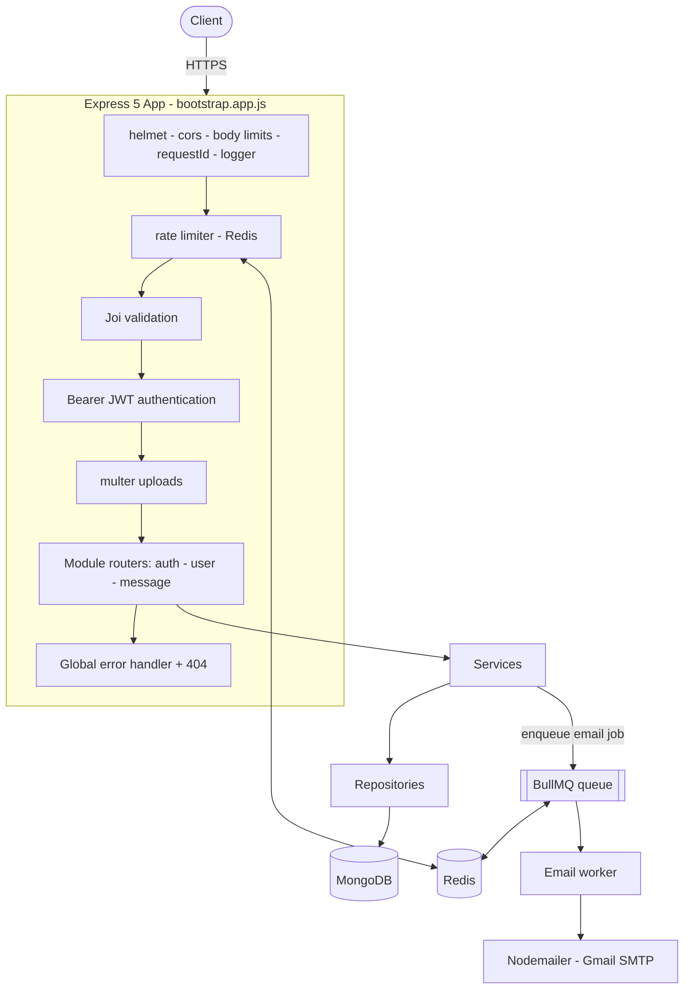
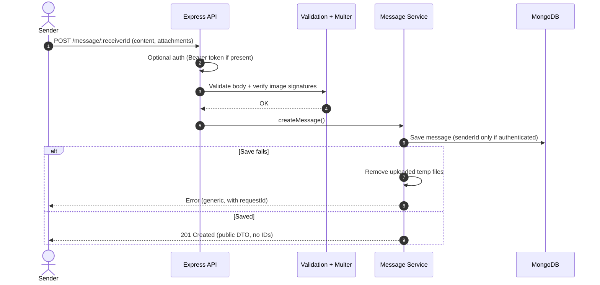
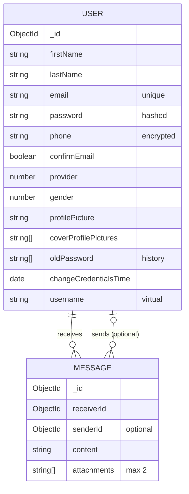
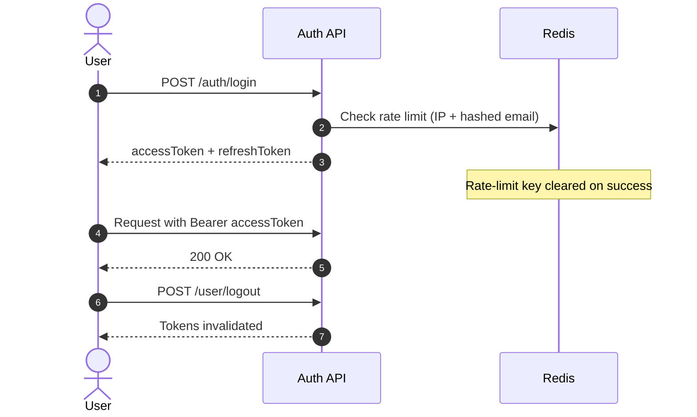

<div align="center">

# 🕶️ Saraha App — Backend API

**A production-minded backend for an anonymous-messaging platform.**
Share your link. Receive honest messages. The sender stays hidden.

<br />


<br /><br />

[Overview](#-overview) ·
[Features](#-features) ·
[Architecture](#-architecture) ·
[Quick Start](#-quick-start) ·
[API](#-api-reference) ·
[Security](#-security) ·
[Operations](#-operations--deployment)

</div>

---

## 📑 Table of Contents

- [Overview](#-overview)
- [Features](#-features)
- [Architecture](#-architecture)
- [Tech Stack](#-tech-stack)
- [Project Structure](#-project-structure)
- [Data Model](#-data-model)
- [Quick Start](#-quick-start)
- [Environment Variables](#-environment-variables)
- [API Reference](#-api-reference)
- [Authentication](#-authentication)
- [File Uploads](#-file-uploads)
- [Security](#-security)
- [Reliability & Observability](#-reliability--observability)
- [Operations & Deployment](#-operations--deployment)
- [Testing](#-testing)
- [Roadmap](#-roadmap)
- [Contributing](#-contributing)
- [License](#-license)

---

## 🎯 Overview

**Saraha App Backend** powers an anonymous-messaging platform. A user shares their profile link, and anyone can send them a message. Messages carry **no public sender**, and a sender is only linked internally when the caller happens to be authenticated.

Beyond messaging, the service ships a complete **identity layer**: signup, email confirmation, password recovery, profile management, JWT-based authorization with token revocation, and Redis-backed rate limiting.

The codebase follows a layered **Route → Controller → Service → Repository** structure, with schema validation at the edge, centralized success/error responses, and a global error handler that never leaks internals in production.

### Highlights

| | |
|---|---|
| 🔐 **Full auth lifecycle** | Signup, confirm email, login, refresh, logout, forgot/reset password |
| 🕶️ **Anonymity by design** | Public DTOs omit sender/receiver IDs and credentials |
| 📬 **Reliable email** | BullMQ + Redis queue, retries, HTML + plain-text templates with escaped values |
| 🛡️ **Hardened HTTP layer** | Helmet, CORS allowlist, body/request limits, rate limiting, request IDs |
| 📖 **Self-documented** | OpenAPI / Swagger UI served at `/docs` |
| 🩺 **Ops-ready** | Liveness/readiness probes, structured JSON logs, graceful shutdown |

---

## ✨ Features

### 🔐 Authentication & Accounts

- **Signup & login** with bcrypt / argon2 password hashing (`hash.security.js`)
- **Email confirmation** with a verification code and a resend flow
- **Password recovery**: request code → verify code → reset password
- **Dual-token JWT** scheme: separate access and refresh tokens, with distinct secrets for `user` and `system` audiences
- **Logout** that invalidates tokens (current session or all sessions)
- **Login rate limiting** keyed by IP + hashed email, cleared on successful login

### 💬 Anonymous Messaging

- Send a message to any receiver by ID with `content` and/or up to **2 image attachments**
- **Optional authentication** on send: with a valid token the sender is recorded internally, without one the message is fully anonymous
- **Inbox**: list your messages, read one, delete one (all protected)

### 👤 User Profiles

- Fetch a public profile and update your own (name, gender, phone, photos)
- Update password with **previous-password history** tracking
- Profile picture upload via local multer storage with server-side signature checks
- Phone numbers are **encrypted at rest** (AES-GCM)

### 🧰 Platform

- **Joi** validation on every route (shared field library in `common/validation/fields.js`)
- **Structured JSON logging** with `requestId`, response time, and no query/credential logging
- **Health endpoints** and **graceful shutdown** for HTTP, MongoDB, Redis and the email worker
- **OpenAPI 3** documentation with Swagger UI

---

## 🏗️ Architecture

### System overview



### Layered design

| Layer | Responsibility |
|---|---|
| **Router** | Route table, middleware composition (validation, auth, uploads) |
| **Controller** | HTTP concerns only: read request, call service, shape response |
| **Service** | Business rules (auth flows, messaging, profile logic) |
| **Repository** | Data access via `database.repository.js` shared CRUD helpers |
| **Common** | Enums, response builders, security utils, email, multer, validation fields |

### Sending an anonymous message



---

## 🧱 Tech Stack

| Layer | Technology |
|---|---|
| **Runtime** | Node.js 24 (ESM, `"type": "module"`) |
| **Framework** | Express 5 |
| **Database** | MongoDB + Mongoose 9 (Atlas or local) |
| **Cache / Rate limit** | Redis 5 (`redis`), `express-rate-limit` |
| **Queue** | BullMQ (Redis-backed) for email delivery |
| **Auth** | `jsonwebtoken`: access + refresh tokens |
| **Hashing** | bcrypt + argon2 |
| **Encryption** | AES-256-GCM (Node `crypto`) |
| **Validation** | Joi |
| **Uploads** | multer (local storage, content-signature validation) |
| **Email** | Nodemailer (pooled transporter, HTML + text templates) |
| **Security** | helmet, cors |
| **Docs** | OpenAPI + Swagger UI |
| **Config** | dotenv |

---

## 🗂️ Project Structure

```text
config/
└── config.service.js                 # Loads env vars (dotenv → config/.env.dev)

src/
├── main.js                           # Entry point
├── bootstrap.app.js                  # Express app: middleware, routers, error handling
│
├── DB/
│   ├── connection.db.js              # MongoDB connect + authenticateDB()
│   ├── radis.connection.db.js        # Redis connection
│   ├── database.repository.js        # Shared CRUD helpers
│   └── models/                       # user · message
│
├── modules/
│   ├── auth/                         # controller · service · validation
│   ├── user/                         # profile, password, logout, image upload
│   └── message/                      # anonymous messaging endpoints
│
├── middleware/
│   ├── authentication.middleware.js  # Bearer-token guard (access / refresh)
│   ├── validation.middleware.js      # Joi validators
│   └── limiter.js                    # Redis-backed rate limiters
│
└── common/
    ├── enums/                        # user · security · email enums
    ├── services/radis.service.js     # Redis helpers (get / set / delete keys)
    ├── validation/fields.js          # Reusable Joi field definitions
    └── utils/
        ├── email/                    # send.email · email templates · BullMQ worker
        ├── multer/                   # local.multer · validation.multer
        ├── response/                 # success.response · error.response
        └── security/                 # hash · token · encryption
```

> **Naming note:** a few legacy file names contain the spelling `radis`. Correct exception names are already exported with backward-compatible aliases; renaming files can be done gradually without breaking imports.

---

## 🧬 Data Model

Full definitions live in `src/DB/models/`.



| Model | Purpose |
|---|---|
| `User` | Accounts, credentials, profile data, password history |
| `Message` | Anonymous messages with optional internal sender link |

### Enums

| Enum | Values |
|---|---|
| `GenderEnum` | `Male` (1) · `Female` (2) |
| `ProviderEnum` | `Google` (1) · `System` (2) |
| `RoleEnum` | `Admin` (0) · `User` (1) |
| `HashApproachEnum` | `bcrypt` · `argon2` |
| `tokenTypeEnum` | `access` · `refresh` |
| `EmailEnum` | `Confirm_Email` · `ForgotPassword` · `Two_Steps_Verification` |

---

## 🚀 Quick Start

### Prerequisites

| Requirement | Notes |
|---|---|
| **Node.js** ≥ 24 | ESM project |
| **MongoDB** | Atlas or local instance |
| **Redis** | Local or hosted (e.g. Redis Cloud). Required for rate limiting and the email queue |
| **Gmail app password** | Optional, only for email flows |

### Installation

```bash
# 1. Clone and install
clone this repo
cd saraha-app
npm install

# 2. Configure environment (config.service.js loads config/.env.dev)
cp .env.example config/.env.dev

# 3. Generate a strong encryption key and paste it into ENC_KEY_BASE64
openssl rand -base64 32

# 4. Start in development mode (auto-reload)
npm run start:dev
```

The API listens on **`http://localhost:3000`** by default.

| URL | Purpose |
|---|---|
| `/docs` | Swagger UI (OpenAPI documentation) |
| `/health/live` | Liveness probe |
| `/health/ready` | Readiness probe (checks dependencies) |

### Scripts

| Command | Description |
|---|---|
| `npm run start:dev` | Start in watch mode |
| `npm run check` | Run syntax checks |
| `npm test` | Run the test suite |
| `npm run test:integration` | Run opt-in live MongoDB/Redis tests |

---

## ⚙️ Environment Variables

> ⚠️ **Never commit real secrets.** `config/.env.dev` is gitignored. Use strong, unique random values for every secret and a secret manager in production.

### Core

| Variable | Description |
|---|---|
| `PORT` | HTTP port (default `3000`) |
| `ORIGINS` | Comma-separated CORS allowlist |
| `APPLICATION_NAME` | App name used in email templates |
| `TRUST_PROXY_HOPS` | Trusted proxy hop count. Set **only** behind a known reverse proxy, and match your real topology |

### Data stores

| Variable | Description |
|---|---|
| `DB_URI` | MongoDB connection string |
| `RUDIS_URI` | Redis connection string (name kept as used in code) |

### Security & tokens

| Variable | Description |
|---|---|
| `SALT_ROUND` | Hashing cost factor (default `10`) |
| `ENC_KEY_BASE64` | **Required.** Random 32-byte AES-GCM key, Base64-encoded |
| `LEGACY_ENC_BYTE` | Old raw 32-byte CBC key, used **only** while migrating legacy encrypted phone values |
| `USER_TOKEN_SECRET_KEY` | User access-token secret |
| `USER_REFRESH_TOKEN_SECRET_KEY` | User refresh-token secret |
| `System_TOKEN_SECRET_KEY` | System access-token secret |
| `System_REFRESH_TOKEN_SECRET_KEY` | System refresh-token secret |
| `ACCESS_EXPIRES_IN` | Access token TTL (seconds) |
| `REFRESH_EXPIRES_IN` | Refresh token TTL (seconds) |

### Email

| Variable | Description |
|---|---|
| `EMAIL_APP` | Sender Gmail address |
| `EMAIL_APP_PASSWORD` | Gmail app password |

---

## 📡 API Reference

Interactive documentation is available at **`/docs`**. Summary below.

### Auth: `/auth`

| Method | Route | Description |
|---|---|---|
| `POST` | `/auth/signup` | Register a new user |
| `POST` | `/auth/login` | Login and receive access + refresh tokens *(rate-limited)* |
| `PATCH` | `/auth/confirm-email` | Confirm email with the verification code |
| `PATCH` | `/auth/resend-confirm-email` | Resend the confirmation email |
| `POST` | `/auth/request-forgot-password-code` | Request a password reset code |
| `PATCH` | `/auth/verify-forgot-password-code` | Verify the reset code |
| `PATCH` | `/auth/reset-forgot-password-code` | Set a new password |

### User: `/user`

| Method | Route | Auth | Description |
|---|---|:---:|---|
| `GET` | `/user/:userId` | — | Get a public profile (restricted DTO) |
| `PATCH` | `/user/:userId` | ✅ | Update own profile (path ID must match the authenticated user) |
| `PATCH` | `/user/password` | ✅ | Update password |
| `POST` | `/user/logout` | ✅ | Logout and invalidate tokens |
| `PATCH` | `/user/profile-image` | ✅ | Upload profile picture (field `attachment`) |

### Message: `/message`

| Method | Route | Auth | Description |
|---|---|:---:|---|
| `GET` | `/message/list` | ✅ | List my messages |
| `POST` | `/message/:receiverId` | Optional | Send an anonymous message |
| `GET` | `/message/:messageId` | ✅ | Get a message by ID |
| `DELETE` | `/message/:messageId` | ✅ | Delete a message |

### Platform

| Method | Route | Description |
|---|---|---|
| `GET` | `/docs` | Swagger UI |
| `GET` | `/health/live` | Liveness probe |
| `GET` | `/health/ready` | Readiness probe |

### Example requests

```bash
# Login
curl -X POST http://localhost:3000/auth/login \
  -H "Content-Type: application/json" \
  -d '{"email":"user@example.com","password":"YourStrongPassword1!"}'

# Send an anonymous message (no token needed)
curl -X POST http://localhost:3000/message/<receiverId> \
  -F "content=You are doing great!" \
  -F "attachments=@./photo.jpg"

# List my inbox (token required)
curl http://localhost:3000/message/list \
  -H "Authorization: Bearer <accessToken>"
```

---

## 🔑 Authentication

Protected routes require a Bearer token:

```http
Authorization: Bearer <token>
```



- `POST /auth/login` returns an **access** and a **refresh** token.
- Tokens are signed with **separate secrets** for the `user` and `system` audiences.
- `changeCredentialsTime` invalidates tokens issued before a credential change.
- `POST /message/:receiverId` is **optionally authenticated**: with a valid token the sender is recorded internally; without one the message stays fully anonymous.

---

## 📎 File Uploads

| Upload | Endpoint | Field | Limits |
|---|---|---|---|
| Profile image | `PATCH /user/profile-image` | `attachment` | Image only |
| Message attachments | `POST /message/:receiverId` | `attachments` | Max **2 files**, image only, **≤ 1 MB** each |

- File **content signatures** (magic bytes) are verified server-side, not just the extension or MIME header.
- Invalid uploads are **removed immediately**, and uploaded files are cleaned up if saving the message fails.

---

## 🛡️ Security

| Area | Measure |
|---|---|
| **HTTP hardening** | Helmet headers, CORS allowlist (`ORIGINS`), JSON body and request limits |
| **Passwords** | bcrypt / argon2 with configurable cost; password history tracking |
| **Tokens** | Separate access / refresh secrets for user and system; credential-change invalidation |
| **Rate limiting** | Redis-backed limiter on API routes and login (key = IP + hashed email) |
| **Input validation** | Joi on every route; shared, reusable field definitions |
| **Data at rest** | Phone numbers encrypted with AES-256-GCM |
| **Anonymity** | Allowlisted response DTOs omit credentials and sender/receiver IDs |
| **Error handling** | Generic production errors with a `requestId`; stack traces never exposed |
| **Logging** | Structured JSON, no query strings or credentials, no IP address dumps |
| **Email templates** | All interpolated values are HTML-escaped |
| **Uploads** | Signature verification, size and count limits, orphan cleanup |

---

## 📈 Reliability & Observability

- **Structured logs**: JSON logs with levels, `requestId` and response-time metrics
- **Health probes**: `/health/live` and `/health/ready` for orchestrators (Kubernetes, ECS, etc.)
- **Graceful shutdown**: `SIGTERM` / `SIGINT` stop the HTTP server, then close MongoDB, Redis and the email worker
- **Email queue**: BullMQ jobs with retries and status logging, so email outages never block API requests
- **Explicit index management**: `syncIndexes()` no longer runs on every boot

---

## 🚢 Operations & Deployment

### Pre-launch checklist

- [ ] Set every secret via a **secret manager**, never from a committed `.env`
- [ ] Set `ENC_KEY_BASE64` (generate with `openssl rand -base64 32`)
- [ ] Set `ORIGINS` to your real frontend domains only
- [ ] Set `TRUST_PROXY_HOPS` to match your actual reverse-proxy chain, and leave it unset otherwise
- [ ] Verify **Redis** connectivity in the target environment
- [ ] Run `npm audit` and review results
- [ ] Take a **database backup** before the first production run

### Encryption migration

If existing phone values were encrypted with the older raw 32-byte CBC key:

1. Set `ENC_KEY_BASE64` for the new AES-GCM key.
2. Provide the old key as `LEGACY_ENC_BYTE`.
3. Decrypt and re-encrypt existing records (test on a copy first).
4. Remove `LEGACY_ENC_BYTE`.

> Never use an example placeholder as a production key, and never run the migration on production data without a verified backup.

### Important behaviors

| Behavior | Detail |
|---|---|
| **Rate limiter is fail-closed** | If Redis is unavailable, rate-limited requests fail rather than bypass protection. This is intentional |
| **Dependency audit** | Do **not** run `npm audit fix --force` blindly. Review version changes first |
| **Proxy trust** | A wrong `TRUST_PROXY_HOPS` value can let clients spoof IPs and weaken rate limiting |

---

## 🧪 Testing

```bash
npm run check   # syntax checks
npm test        # unit tests
```

Current coverage includes DTO shaping, upload/file validation, encryption, OTP, authentication/session security, and message pagination.

### Live MongoDB and Redis tests

Copy `.env.test.example` to a private environment file and export its values. These tests run only when `CONFIRM_TEST_SERVICES=true` and require a dedicated MongoDB database whose name includes `test`; they must never point to production.
`npm run test:integration` intentionally fails when those values are absent, so a skipped test can never be mistaken for a successful infrastructure check.

```bash
TEST_DB_URI='mongodb://127.0.0.1:27017/saraha_test' \
TEST_REDIS_URI='redis://127.0.0.1:6379/15' \
CONFIRM_TEST_SERVICES=true \
npm run test:integration
```

---

## 🗺️ Roadmap

- [ ] Periodic job to purge orphaned attachments
- [x] Opt-in integration tests for Redis OTP and MongoDB message pagination
- [ ] Separate dev / test / production configuration profiles
- [ ] Gradual rename of legacy `radis` files (with compatibility aliases)
- [ ] Metrics endpoint (latency, Redis / Mongo / email failures)
- [ ] Object storage (S3-compatible) for uploads
- [ ] Docker & Docker Compose setup
- [ ] CI pipeline (lint, test, audit)

---

## 🤝 Contributing

1. Fork the repository and create a feature branch: `git checkout -b feat/my-feature`
2. Keep the **Route → Controller → Service → Repository** layering
3. Add Joi validation for any new input and update the OpenAPI docs
4. Run `npm run check && npm test` before opening a pull request
5. Never commit secrets or `.env` files

---

## 📄 License

Released under the **ISC** License.

<div align="center">

<br />

Built by Kamal Mohamed

</div>
